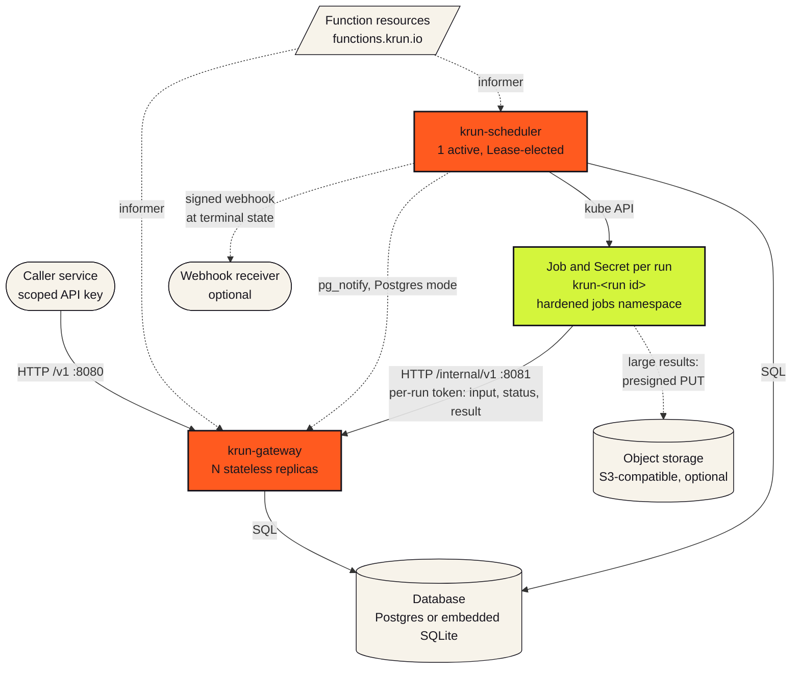
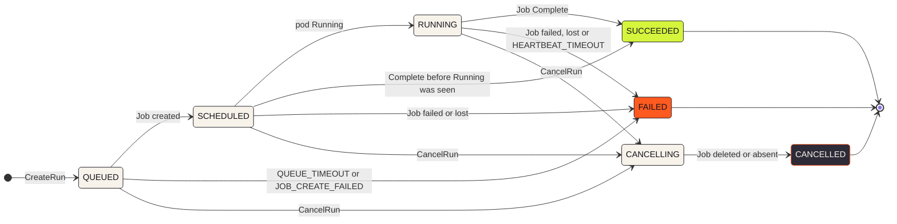

<div align="center">

<a href="https://xenarro.github.io/krun/">
  <picture>
    <source media="(prefers-color-scheme: dark)" srcset="docs/assets/logo-dark.svg">
    
  </picture>
</a>

### HTTP in. Result out. 🎫

**krun runs HTTP-triggered functions as one-off Kubernetes Jobs.**<br>
Submit JSON over HTTP; receive durable status, an inline or object-storage result,
and classified failures without giving callers Kubernetes credentials.

[](https://github.com/xenarro/krun/actions/workflows/ci.yml)
[](https://github.com/xenarro/krun/actions/workflows/pages.yml)
[](docs/STACK.md)
[](docs/STACK.md)
[](docs/STACK.md)
[](deploy/helm/krun/README.md)
[](deploy/helm/krun/README.md)
[](https://xenarro.github.io/krun/)
[](#contributing-)
[](#release-preparation-not-publication)

**[📖 Docs](https://xenarro.github.io/krun/)** &nbsp;·&nbsp;
**[🚀 Quickstart](#quickstart-)** &nbsp;·&nbsp;
**[🚇 Architecture](#architecture-)** &nbsp;·&nbsp;
**[📡 API](#public-api-summary)** &nbsp;·&nbsp;
**[🤝 Contributing](#contributing-)**

</div>

> [!IMPORTANT]
> **Pre-release, and honest about it.** Version 0.1.0 is prepared, not published: there is
> no tag, container image, OCI chart, npm package or PyPI package yet, so every path below
> starts from a source checkout. A license has not been published yet. See
> [Release preparation](#release-preparation-not-publication) and [License](#license).

## TL;DR ⚡

**You POST JSON. krun runs it as its own Kubernetes Job. You get a durable status, a
result and, if it breaks, a reason.** Your callers never see a kubeconfig.

- 🎫 **One request, one Job.** `POST /v1/functions/{function}/runs` validates the input,
  queues the run, and the scheduler turns it into a dedicated Job with `backoffLimit: 0`.
- 🧾 **Answers that stick.** Poll, wait on or watch (SSE) every run; fetch its result inline
  or through a presigned object-storage URL; read `failureReason` and `logTail` when it fails.
- 🔍 **Kubernetes is the witness.** The truth about a run comes from Kubernetes, never from
  the function's own reports: the Job's status and exit code decide the terminal state.
- 🔐 **Three roles, cleanly split.** Callers hold a scoped API key. Function authors ship an
  image plus a `Function` resource. The platform team runs two processes, one database and
  one CRD.
- 🧱 **Small footprint.** Gateway, scheduler, managed Postgres or embedded SQLite, one CRD,
  one Helm chart. No new queue, no new cluster.

## What's on board ✨

<table>
<tr>
<td width="33%" valign="top">

**🌐 Plain HTTP for callers**

Create, get, list, wait on, watch (SSE), cancel and fetch results over `/v1`. Callers hold a
scoped API key, never Kubernetes credentials.

</td>
<td width="33%" valign="top">

**🎫 One Job per run**

Each run gets its own Job and immutable per-run Secret in a hardened namespace. Both are
deleted once the outcome is recorded.

</td>
<td width="33%" valign="top">

**✅ Validated before it queues**

Every Function declares a JSON Schema 2020-12 `inputSchema`. Bad input is a 400
`INPUT_SCHEMA_VIOLATION` before any Job exists.

</td>
</tr>
<tr>
<td width="33%" valign="top">

**🔁 Idempotent by `requestId`**

Same id, same payload: the same run comes back with `Idempotent-Replay: true`. Same id,
different payload: 409 `IDEMPOTENCY_CONFLICT`.

</td>
<td width="33%" valign="top">

**🩺 Failures with a reason**

Every failed run carries a `failureReason` such as `EXIT_CODE`, `OOM_KILLED` or
`DEADLINE_EXCEEDED`, plus the last 100 log lines when the container ran.

</td>
<td width="33%" valign="top">

**🪣 Results inline or in a bucket**

Up to 256 KiB inline by default. Bigger results go to S3-compatible storage through presigned
URLs; pods never see bucket credentials.

</td>
</tr>
<tr>
<td width="33%" valign="top">

**🚦 Backpressure built in**

Per-key rate limits, per-Function `maxQueued` and `maxConcurrency`, a global running cap,
`queueTimeout` and `activeDeadlineSeconds`. Bursts wait in the queue.

</td>
<td width="33%" valign="top">

**📬 Signed webhooks**

Optional HMAC-SHA256 callbacks at the terminal state: at least once, six attempts over about
15 hours, SSRF address checks on every target.

</td>
<td width="33%" valign="top">

**🔒 Hardened by default**

Pod Security `restricted`, default-deny NetworkPolicies, digest-pinned images, non-root,
read-only root filesystem, no service-account token in pods.

</td>
</tr>
<tr>
<td width="33%" valign="top">

**🗄️ Two storage modes**

Postgres for replicated gateway and scheduler processes, or embedded SQLite in one Pod with
a PVC and optional Litestream replication.

</td>
<td width="33%" valign="top">

**📈 Observable**

Prometheus metrics on the admin port, OTLP traces when you configure an endpoint, and seven
ready-made, opt-in `PrometheusRule` alerts in the chart.

</td>
<td width="33%" valign="top">

**🧰 SDKs and a CLI**

Dependency-free Node.js 22+ and Python 3.11+ SDKs with a local mode, plus `krun init`,
`deploy` and `validate`. Or skip them: any HTTP client speaks the contract.

</td>
</tr>
</table>

## Architecture 🚇

A gateway authenticates and admits Runs. One elected scheduler creates Jobs,
observes their actual exits, persists transitions and sends optional signed
webhooks. Function definitions are Kubernetes `Function` resources, not HTTP
create/update endpoints. Node.js and Python SDKs implement the small internal
HTTP contract; any container with an HTTP client can implement it instead.



| Component | Role |
|---|---|
| `krun-gateway` | Public `/v1` (auth, validation, idempotency, insert run, status, wait, SSE, result, cancel request) and the internal `/internal/v1` API on a second port. N stateless replicas; reads `functions.krun.io` in the krun namespace. |
| `krun-scheduler` | Claims queued runs, creates Jobs, watches Jobs and Pods, transitions state, detects failures and heartbeat timeouts, cancels, delivers webhooks, sweeps retention. One active, standbys allowed, Kubernetes Lease election. |
| Database | System of record: managed Postgres (16+), or SQLite in embedded mode. |
| Jobs namespace | Dedicated and hardened; holds Job pods and per-run Secrets. |
| Object storage | Optional, S3-compatible; only for results larger than `KRUN_MAX_RESULT_BYTES`. |

- 🔌 **The database is the only contract** between gateway and scheduler. No RPC: when the
  scheduler is down, the gateway still accepts runs and they queue.
- 🧩 **One container image, four entrypoints:** `krun gateway`, `krun scheduler`,
  `krun migrate` and `krun validate`.
- 🚪 **Ports:** public 8080, internal 8081, admin 9090 on both processes (`/healthz`,
  `/readyz`, `/metrics`); the embedded scheduler's admin port is 9091.

📖 Deep dive: [Architecture on the docs site](https://xenarro.github.io/krun/reference/architecture/)
and [SPEC.md](SPEC.md) section 2.

## How it works 🚉

Every run is a one-way ticket: it rides QUEUED, SCHEDULED and RUNNING and stops at a
terminal. There are no automatic retries; a client retries by submitting a new run.

1. 🎫 **Issue.** A service calls CreateRun with JSON input and its API key. The gateway checks
   the key's scope and rate limit, dedupes on `requestId`, validates the input against the
   Function's `inputSchema`, enforces `maxQueued` and inserts a `QUEUED` run. It answers
   201 at once or, with `wait`, holds the response until the run is terminal or the wait
   elapses (capped at `maxWait`, 60 s by default).
2. 🚉 **Schedule.** Within `maxConcurrency` and the global running cap, the elected
   scheduler claims the run and creates an immutable Secret `krun-<run id>` holding a
   per-run token, plus a Job of the same name in the jobs namespace: `SCHEDULED`.
3. 🏃 **Run.** The pod starts (`RUNNING`), fetches its input from the internal API with its
   token, reports progress if it likes, and writes its result (or uploads a large one to a
   presigned URL).
4. 🏁 **Terminal.** The scheduler watches the Job, not the function's claims. Exit 0 is
   `SUCCEEDED`. A nonzero exit, OOM kill, deadline, eviction, lost Job or missed heartbeat
   is `FAILED`, with a `failureReason` (and a `logTail` when the container ran). The Secret
   and Job are deleted, and an optional signed webhook goes out.
5. 📥 **Collect.** Callers use GetRun, WaitRun or WatchRun, then GetRunResult: 200 with the
   inline document, or a 307 to a short-lived presigned GET.



Once a run is `CANCELLING`, its only terminal state is `CANCELLED`. Every transition is a
compare-and-set, and every failed run carries a `failureReason`: `EXIT_CODE`, `OOM_KILLED`,
`DEADLINE_EXCEEDED`, `EVICTED`, `DISRUPTED`, `HEARTBEAT_TIMEOUT`, `JOB_CREATE_FAILED`,
`JOB_LOST` or `QUEUE_TIMEOUT`.

## When to use krun ✅

Use krun for bounded, isolated batch work, internal report generation and
HTTP-triggered compute that already belongs on Kubernetes. Choose Postgres for
replicated gateway/scheduler processes and a separately operated database.
Choose embedded SQLite for a single shared Pod and PVC, accepting downtime
on restart/upgrade; optional Litestream replication is an operations concern.

Think reports, exports, batch inference, data migrations, media processing and third-party
integrations: runs of about 10 seconds to several hours, up to a few runs per second
sustained, with bursts absorbed by the queue. Cold start is seconds, dominated by
scheduling and image pull.

## When not to use krun 🚫

- Not an always-warm, sub-second request handler: every run creates a Job.
- Not a workflow/DAG engine, cron scheduler, automatic retry engine, broker,
  autoscaler, multi-region control plane or dashboard.
- Not hostile-code multitenancy. Function authors and the platform team share
  a trust boundary; PSA, quotas and default-deny networking reduce blast radius,
  but function-image signature verification belongs to platform admission.
- Not a Kubernetes replacement or an SDK-only local gateway emulator. SDK local
  mode runs a handler once without network access.
- Not an assertion that package names, OCI artifacts or a release are published.
  P0.9/P9.5 publication prerequisites and release acceptance remain separate.

The normative design and boundaries are [SPEC.md](SPEC.md), the
[public API](docs/API.md), [internal API](docs/INTERNAL-API.md),
[stack](docs/STACK.md) and [operations guide](docs/OPERATIONS.md).
The [chart reference](deploy/helm/krun/README.md) lists every value.
Historical implementation receipts moved unchanged to
[DEVELOPMENT-HISTORY.md](DEVELOPMENT-HISTORY.md); they are not current status claims.

## Quickstart 🚀

**Both database modes on a disposable kind cluster, from a source checkout.**

This is a source-checkout rehearsal, not a production installer. It uses only
`kind-krun-test-e2e`, a private kubeconfig and the checkout-owned loopback
registry. It refuses an existing platform/namespace, foreign registry or
non-loopback cluster. It never uses your ambient Kubernetes context.

**You need:** the pinned Node 26, pnpm, Helm 4, kind and kubectl versions,
Docker, npm, GNU `timeout` and uv from [the e2e guide](test/e2e/README.md). Kubernetes 1.33+
and a CNI that actually enforces NetworkPolicy are required. Work from this
checkout, retain its private TMPDIR state during recovery and install the
locked dependencies with their existing supply-chain policy:

```sh
pnpm install --frozen-lockfile
make build
```

Run the complete acceptance (fresh cluster per mode; unchanged 1,800-second
budget per mode, with a positive open/deny/reopen network-policy control):

```sh
make e2e-quickstart
```

It invokes the actual `scripts/quickstart.sh` with the local chart, pushed
platform image, workspace CLI, current packed Node SDK and local registry. Along the way it:

- installs the platform, uses `krun init`, vendors the SDK before `krun deploy` and tests the
  generated project;
- waits for current-generation `Ready=True`, submits a real Run and verifies `{ "rows": 42 }`
  through GetRun;
- uses the same Node function in both modes; Postgres mode provisions the pinned, restricted
  disposable Postgres 18 fixture;
- generates API keys and database credentials, passes them only through private Secret
  inputs, and never prints them.

The demo needs only an inline result: S3 and webhook configuration are not
silently inferred or enabled. The existing complete native corpus separately
covers both SDK languages, object storage, webhooks and other failures.

To invoke a single mode yourself with the exact unpublished-artifact overrides:

```sh
make kind-up
mkdir -p "$TMPDIR/krun-test-quickstart-sdk"
pnpm --dir sdk/node pack --pack-destination "$TMPDIR/krun-test-quickstart-sdk"
KRUN_CHART="$PWD/deploy/helm/krun" \
KRUN_IMAGE=localhost:5001/krun:e2e \
KRUN_CLI="node $PWD/packages/cli/dist/main.js" \
KRUN_SDK_VENDOR="$TMPDIR/krun-test-quickstart-sdk" \
KRUN_REGISTRY=localhost:5001 \
  scripts/quickstart.sh embedded
make kind-down
```

Repeat on a fresh `make kind-up` with `scripts/quickstart.sh postgres` and the
same overrides.

| Variable | Script default | Local acceptance override |
|---|---|---|
| `KRUN_CHART` | `oci://ghcr.io/xenarro/charts/krun` | local `deploy/helm/krun` path |
| `KRUN_IMAGE` | unset; chart image/tag defaults | pushed `localhost:5001/krun:e2e` (`repository:tag`) |
| `KRUN_CLI` | `npx @krun/cli` | `node /absolute/checkout/packages/cli/dist/main.js` |
| `KRUN_SDK_VENDOR` | unset; generated project resolves its published SDK | directory containing the current Node SDK `.tgz` |
| `KRUN_REGISTRY` | `localhost:5001` | same owned loopback registry; this demo refuses remote publication |

<details>
<summary><b>🧹 Cleanup, TMPDIR and lock recovery</b></summary>

<br>

- `TMPDIR` must name an existing writable private directory; use the same value for setup,
  rehearsal and cleanup.
- The vendor directory must contain exactly one Node SDK `.tgz`; use a new empty directory
  for a new pack.
- The script automatically removes its own chart, generated project, credentials, CRD and
  demo namespaces on normal success/failure. The acceptance driver also removes its
  cluster/registry.
- After a normally joined manual run, use `make kind-down`; never delete an unrelated
  cluster or change an ambient context.
- A shared foundation lease prevents setup/teardown from racing another job; busy locks fail
  closed. A hard interruption requires verifying that every owning/borrowing process has
  stopped before exclusive lock recovery, as explained in the e2e guide.
- This disposable cleanup deliberately disables the chart's CRD/jobs-namespace `keep`
  values; do not copy that setting into a durable installation.

</details>

<details>
<summary><b>🔧 Override rules</b></summary>

<br>

- `KRUN_CLI` is an executable plus plain space-separated arguments, not a shell program: no
  `eval`, pipes, substitutions or quoting. Use an executable wrapper when a path contains
  spaces.
- Chart URLs must not contain userinfo, query strings or fragments: keep authentication in
  Helm's private configuration, never a chart reference copied to argv or logs. Local paths
  and credential-free HTTP(S)/OCI references retain their exact spelling.
- Published defaults are configurable interfaces, not evidence that registry/package
  ownership or publication has been accepted. Use the explicit local overrides until release
  prerequisites are verified.

</details>

📖 Step by step, with tabs per mode: [Quickstart on the docs site](https://xenarro.github.io/krun/start/quickstart/).

### Measured quickstart durations

Actual local repair qualification, 2026-11-04 (seconds, rounded to three decimals):

| Mode | `quickstart.sh` incl. demo cleanup | Fresh setup, rehearsal and infrastructure cleanup | Exit |
|---|---:|---:|---:|
| embedded | 119.026 | 325.989 | 0 |
| postgres | 39.688 | 291.738 | 0 |

Both complete fresh-mode commands and the scripts finished below the unchanged
1,800-second per-mode limit. The complete duration includes kind/registry and
MinIO provisioning, freshly generated/packed SDK fixtures, the stock chart's
positive CNI control, the actual script, and owned cluster/registry removal.
The script's own clock starts after that control release is removed; its
platform image is consequently cached in the node. Host Docker layer caches
were also warm. These are measured local Node-template rehearsals, not a
cold-cache guarantee, a hosted CI result, package-publication acceptance or a
production-capacity claim. No public mutation was retried.

## Examples 🧪

### A handler

This is what `krun init --lang node reports-demo` generates as `handler.js`. The handler
starts only when the file is run as the entrypoint, so tests can import `handle`.

```js
import { pathToFileURL } from "node:url";
import { run } from "@krun/sdk";

export async function handle(input, ctx) {
  await ctx.status("loading", 0.1);
  return { rows: 42 };
}

if (process.argv[1] && import.meta.url === pathToFileURL(process.argv[1]).href) {
  run(handle);
}
```

<details>
<summary><b>🐍 The same handler in Python</b> (<code>krun init --lang python</code>)</summary>

<br>

```python
from krun import run


def handle(input, ctx):
    ctx.status("loading", 0.1)
    return {"rows": 42}


if __name__ == "__main__":
    run(handle)
```

</details>

### A Function

The generated `function.yaml` declares the input contract. `REPLACE_WITH_DIGEST` is
intentionally invalid: `krun deploy` replaces it with `<registry>/<name>@sha256:...`,
because tags are rejected. The generated file also starts with an editor-schema comment; the
working schema is [docs/schemas/function-v1alpha1.json](docs/schemas/function-v1alpha1.json).

```yaml
apiVersion: krun.io/v1alpha1
kind: Function
metadata:
  name: "reports-demo"
spec:
  image: REPLACE_WITH_DIGEST
  inputSchema:
    type: object
    required: [name]
    properties:
      name:
        type: string
        minLength: 1
    additionalProperties: false
  heartbeatTimeout: 5m
```

### Local mode

Inside the generated project (after `npm install` or `uv sync`), leave `KRUN_GATEWAY_URL`
unset and the SDK reads JSON from a file or stdin, writes only the result to stdout (both
starters print `{"rows":42}`) and sends status and logs to stderr.

```sh
printf '%s\n' '{"name":"world"}' | node handler.js
printf '%s\n' '{"name":"world"}' | uv run python handler.py
```

### Calling it

From any service with a key that has the right scopes. `$RUN` is the `{run}` id from the
returned resource name; `-` stands in for the function name.

```sh
# create and wait up to 30 seconds; resending the same requestId and body replays the run
curl -sS -X POST "$KRUN_API_URL/v1/functions/reports-demo/runs?requestId=$(uuidgen)&wait=30s" \
  -H "Authorization: Bearer $KRUN_API_KEY" -H "Content-Type: application/json" \
  -d '{ "input": { "name": "world" } }'

# wait again until terminal (or the timeout)
curl -sS -X POST "$KRUN_API_URL/v1/functions/-/runs/${RUN}:wait" \
  -H "Authorization: Bearer $KRUN_API_KEY" -H "Content-Type: application/json" -d '{ "timeout": "60s" }'

# watch live as server-sent events
curl -sS -N "$KRUN_API_URL/v1/functions/-/runs/${RUN}:watch" -H "Authorization: Bearer $KRUN_API_KEY"

# result: the inline document, or a 307 to object storage (follow without the bearer header)
curl -sS "$KRUN_API_URL/v1/functions/-/runs/${RUN}:getResult" -H "Authorization: Bearer $KRUN_API_KEY" -o result.json -w '%{http_code}\n'

# cancel
curl -sS -X POST "$KRUN_API_URL/v1/functions/-/runs/${RUN}:cancel" \
  -H "Authorization: Bearer $KRUN_API_KEY" -H "Content-Type: application/json" -d '{}'
```

No SDK at all? The contract is plain HTTP: [a conforming function in shell](docs/INTERNAL-API.md#9-example-a-conforming-function-in-shell)
uses nothing but curl. 📖 More: [Writing a function](https://xenarro.github.io/krun/guides/writing-a-function/)
and [Invoking runs over HTTP](https://xenarro.github.io/krun/guides/invoking-runs/).

## Golden path on an operated platform

The platform team supplies a registry prefix, krun namespace, jobs namespace,
public API URL and a privately delivered API key. Configure your Kubernetes
identity for that approved context; do not set `KRUN_GATEWAY_URL` on your
workstation, because that selects the SDK's in-Pod mode.

```sh
npx @krun/cli init --lang node reports-demo
# Or: npx @krun/cli init --lang python reports-demo
cd reports-demo
npm install
npm test
npx @krun/cli deploy --namespace "$KRUN_NAMESPACE" \
  --api-url "$KRUN_API_URL" --registry "$KRUN_REGISTRY"
```

> [!NOTE]
> `npx @krun/cli` is the planned published entrypoint; it is not available until a release
> is published. From a checkout, run `make build` and use
> `node /absolute/checkout/packages/cli/dist/main.js` in its place, exactly as the
> quickstart's `KRUN_CLI` override does.

For Python use `uv sync` and `uv run pytest` instead of npm. Before unpublished
local deployment, copy the SDK archive/wheel into `vendor/` and install it from
there, as in the generated README. Deploy always builds and pushes, obtains the
registry's digest, validates the manifest and applies it; `--no-apply` leaves
application to GitOps. It prints a credential-free first-run curl, in-flight log
command and GetRun hint. Run these with your privately configured key:

```sh
curl --fail-with-body "$KRUN_API_URL/v1/functions/reports-demo/runs?wait=30s" \
  -H "Authorization: Bearer $KRUN_API_KEY" -H 'Content-Type: application/json' \
  --data '{"input":{"name":"reports-demo"}}'
# Set RUN_NAME to the response's full functions/.../runs/... name, then:
curl --fail-with-body "$KRUN_API_URL/v1/$RUN_NAME" \
  -H "Authorization: Bearer $KRUN_API_KEY"
```

The first command waits up to 30 seconds, not necessarily to completion;
use `POST ...:wait` with `{ "timeout": "30s" }` until terminal, or `GET ...:watch`
for BASIC server-sent events. Read `logTail` in a failed FULL Run after the
native Job has gone. Do not echo keys, input, results or signed URLs to logs.

## Platform-team onboarding

1. Install the chart using [OPERATIONS](docs/OPERATIONS.md) and the generated
   chart reference. Create its `apiKeys.existingSecret` before Helm; the chart
   never creates a Secret or Function. Label the release namespace restricted.
   Supply an existing database Secret for Postgres. Verify default-deny CNI
   enforcement, image policy and any S3/receiver egress before handover.
2. Add a key to the private `keys.yaml` document with a unique principal name,
   scopes `functions:read`, `runs:read`, `runs:write`, and only the team's Function
   globs (for example `reports-*`). Preserve other principals; avoid `admin`.
   Update the existing Secret from the private file, never by putting material
   in Helm values, a command argument or a committed manifest. Keys reload on
   a 30-second content-hash poll. For rotation retain the same principal name
   and use a `key` array containing old/new private values in that single entry
   (duplicate names are rejected). Wait for reload, switch clients, then remove
   the old value.
3. Bind the existing namespace Roles to the team's authenticated Kubernetes
   group. These roles intentionally ship without team bindings:

   ```sh
   kubectl --context "$PLATFORM_CONTEXT" -n "$KRUN_NAMESPACE" create rolebinding reports-authors \
     --role=krun-function-author --group=reports-developers
   kubectl --context "$PLATFORM_CONTEXT" -n "$KRUN_JOBS_NAMESPACE" create rolebinding reports-logs \
     --role=krun-job-viewer --group=reports-developers
   ```

4. Hand over the approved context, both namespace names, registry prefix and
   public URL, with the API key through a separate private channel. Kubernetes
   author/log permissions and HTTP API-key scopes are separate grants. Authors
   may manage Function resources and inspect in-flight Job logs; neither Role
   grants secret reads, pod exec, workload creation or cluster-admin access.
   Expose only public port 8080 through the optional HTTPRoute/TLS edge. Keep
   internal 8081 and admin ports private; configure `networkPolicy.metricsFrom`
   explicitly (its empty default allows any source to admin ports).

📖 Install, values and runbooks: [Installation](https://xenarro.github.io/krun/start/installation/),
[Operations](https://xenarro.github.io/krun/guides/operations/) and the
[chart reference](https://xenarro.github.io/krun/reference/generated/helm-chart/).

## Function container contract

- Digest-pinned image, non-root numeric UID/GID, read-only root filesystem,
  dropped capabilities, no service-account token. Write transient files only
  under `/tmp`; there is no persistent per-run filesystem or warm process.
- Fetch input from the internal API, never an environment variable or manifest.
  `KRUN_RUN_ID`, `KRUN_FUNCTION`, `KRUN_GATEWAY_URL` and a per-run `KRUN_TOKEN`
  identify/authenticate the execution. Input is JSON-equivalent to submission.
- Optionally report progress; write the result before exit, or upload a large
  result through the scoped `KRUN_RESULT_UPLOAD_URL` when configured. Do not
  send the run token with an object-store upload. A per-run token is dead from
  `CANCELLING` onward or any terminal transition, and is also bounded by its
  active-deadline lifetime. A waiting client's disconnect does not revoke it.
- Exit 0 means success; nonzero means failure. Report an application error
  before nonzero exit. No automatic Job retries. Heartbeats are optional per
  Function; CPU-bound handlers can starve SDK heartbeat processing.
- The Node 22+ and Python 3.11+ SDKs have no runtime dependencies. Without
  `KRUN_GATEWAY_URL`, local mode reads JSON from a file/stdin and writes only
  the result to stdout; progress/logs go to stderr. Neither SDK provides a
  local gateway emulator. See [the internal contract](docs/INTERNAL-API.md).

## Public API summary

All calls use the public `/v1` listener and a scoped bearer API key. JSON fields
are lowerCamelCase, states and failure reasons UPPER_SNAKE_CASE. Ready/allowed
Functions are read-only through HTTP; Kubernetes is their write API.

| Operation | HTTP path (under `/v1`) | Scope |
|---|---|---|
| List/GetFunction | `GET /functions`, `GET /functions/{function}` | `functions:read` |
| Create/ListRuns | `POST` / `GET /functions/{function}/runs` | `runs:write` / `runs:read` |
| GetRun | `GET /functions/{function}/runs/{run}` | `runs:read` |
| Wait/CancelRun | `POST /functions/{function}/runs/{run}:wait` / `:cancel` | `runs:read` / `runs:write` |
| WatchRun | `GET /functions/{function}/runs/{run}:watch` (SSE, BASIC) | `runs:read` |
| GetRunResult | `GET /functions/{function}/runs/{run}:getResult` | `runs:read` |

GetRun/CreateRun/WaitRun/CancelRun are FULL by default; lists, watches and
webhooks are BASIC and exclude input, result, error details and log tail.
Use the returned resource name, opaque pagination tokens and documented view
rules. An optional `requestId` (at most 128 characters; UUID recommended)
deduplicates CreateRun per key name and Function while the Run row remains;
it is not permission to blindly retry mutations. Queue limits
return 429 with `Retry-After`. Stored results may return an authenticated,
bodyless 307 to a short-lived signed GET URL; never forward the API key to it.
Webhooks are at-least-once, signed over raw BASIC bytes, and require receiver
deduplication. Full routes, errors and examples: [docs/API.md](docs/API.md).

📖 Browsable: [Public API contract](https://xenarro.github.io/krun/reference/generated/public-api/)
and the [internal API contract](https://xenarro.github.io/krun/reference/generated/internal-api/).
Machine-readable: [openapi-public.json](docs/api/openapi-public.json) and
[openapi-internal.json](docs/api/openapi-internal.json) (OpenAPI 3.1).

## Verify and operate

`make check` runs types, format/lint, TypeScript/Python tests and unused-code
checks. `make e2e` runs the complete existing native scenario corpus in both
modes; `make e2e-quickstart` separately owns a fresh cluster for each README
rehearsal without changing that corpus's timeouts/retry policy. CI has a separate
30-minute-per-mode quickstart matrix with always-run owned infrastructure
cleanup. Implementation-local qualification is not a claim of hosted delivery.

The native corpus includes a real embedded Litestream/MinIO recovery drill:
a pre-drill Run is read from an independent S3 restore before primary deletion,
then read back unchanged after the chart restores the database. A subsequent
Run must succeed. The measured embedded restore-to-Ready downtime was
56.040 seconds in the local 2026-11-04 e2e run; see OPERATIONS
for the measurement boundaries and production RPO/RTO limitations.
`node scripts/check-operations-alerts.ts` checks every documented alert name
against the real PrometheusRule rendered in both modes.

The P9.6 source snapshot in [PR #100](https://github.com/xenarro/krun/pull/100)
passed [hosted CI](https://github.com/xenarro/krun/actions/runs/41870385177)
with all 44 native scenarios, the
[both-mode fresh quickstarts](https://github.com/xenarro/krun/actions/runs/41870385406)
and the [release dry-run](https://github.com/xenarro/krun/actions/runs/41870385456).
This verifies the listed Phase 9 rehearsal gates, not full Phase 9 or v1
completion: P9.5 registry ownership and publication remain owner-blocked.
Protected-main independent review and merge are separate from pushed-source
qualification; no auto-merge is enabled.

For durable installs, capacity, backup/restore, upgrades, key rotation, telemetry,
alerts, object-store lifecycle and keep/adoption consequences, read
[OPERATIONS](docs/OPERATIONS.md). The Phase 9 release dry-run/publication gate
remains separate from quickstart and benchmark qualification.

## Measured native Job benchmark (P9.3)

Measured 2026-11-03 on local kind (not a CI runner): one Kubernetes 1.37.0
control-plane node, Node 26.7.0, AMD Ryzen 7 5700X 8-Core Processor
(16 visible logical CPUs), 60.7 GiB host RAM. These are host
resources, not a dedicated runner reservation. The unchanged chart installs
one combined gateway/scheduler Pod in embedded mode and two replicas of each
process in Postgres mode, with Postgres 18 and the existing MinIO fixture.
Default-deny enforcement is positively verified before each measurement.

Each mode completes 500 successful runs of the pinned curl-based function
whose measured workload is `sleep 10`, followed by 20 actual `exit 1` runs
of that function. One excluded successful warmup caches the exact image.
The load is closed-loop with 10 clients and Function `maxConcurrency: 10`,
not a simultaneous 500-run burst, an idle-single-run SLO test, or a measurement
of maximum capacity. Existing credential/Pod privacy observers remain active.

| Store mode | Submit→first RUNNING p50 (s) | p95 (s) | Exit→observed FAILED p95 (s) | Completed runs/s |
|---|---:|---:|---:|---:|
| embedded | 2.414 | 6.103 | 11.345 | 0.494 |
| postgres | 1.433 | 13.979 | 8.943 | 0.459 |

The documented under-15-second startup target is met by both loaded samples;
the idle-cluster target is not independently certified by this load test.
Embedded failure-detection p95 is **11.345 seconds**, above the documented
under-10-second aspiration: do not treat that target as demonstrated.

<details>
<summary><b>📐 How these numbers were measured</b></summary>

<br>

Percentiles use nearest rank over the complete populations (500 success and
20 crash samples), without interpolation or dropping failures. Submit time
is recorded immediately before CreateRun. GetRun observes first RUNNING at
200 ms intervals; WaitRun observes terminal state. Throughput is 500 divided
by the full window from first submission to last successful terminal response,
not HTTP admission rate. Failed outcomes must carry `EXIT_CODE`. Detection
latency subtracts the actual native container `finishedAt` from the client's
first terminal observation; kind and client share the host clock. Native exit
timestamps have Kubernetes' timestamp precision, and observation/transport
latency is included. This is not the backdated Run `endTime` or the ten-second
function duration.

The scheduler's exact-Function `krun_terminal_detect_seconds` histogram is an
independent second source: its counts advance 1→501→521 in each mode. The
20-crash histogram count/sum deltas are
embedded: 20 / 153.064 seconds; postgres: 20 / 107.192 seconds.
These sums are not p95 estimates. The script rejects missing series, resets,
wrong counts, duplicate Runs, missed RUNNING, wrong terminal reasons or
negative/nonfinite timing evidence. The driver never retries public API
mutations; the fixture retains its existing bounded internal curl transport
behavior. No workload, deadline, security rule or test allowance was relaxed
to produce the numbers.

</details>

Reproduce with `make bench` then `make kind-down`, using the pinned tools in
`test/e2e/README.md`. This is separate from `make e2e` and can take roughly
20–25 minutes per mode. `make bench-build` compiles `scripts/bench.ts` into
`dist/bench/scripts/bench.js`; individual modes can use the existing
`cluster.ts install <mode>`, `cluster.ts verify`, compiled script, and
`cluster.ts uninstall` lifecycle. The script emits sanitized raw per-Run
observations and the summary only after verified owned cleanup; API keys,
input, tokens and connection details never enter the output. The dedicated
`benchmark.yml` workflow runs this same fixed workload on pull requests that
change the benchmark and on demand, with least-privilege permissions and
always-run owned cluster cleanup. Hosted results remain a separate exact-head
delivery gate; these local numbers are not attributed to GitHub Actions.

No Phase 9 release gate, publication or production capacity guarantee is
claimed by this measurement.

## Release preparation (not publication)

The [release guide](docs/RELEASE.md) documents a credential-free rehearsal that
stamps a private snapshot, builds and installs the real Node/Python/CLI/chart
artifacts, checks all SDK export modes, and verifies a non-root image archive.
Publisher preflight rejects extra or non-regular inputs, selects only exact
verified Python paths, and checks canonical npm provenance repository metadata.
The rehearsal does not modify this checkout or publish anything:

```sh
node scripts/release-dry-run.ts 97
```

Version 0.1.0 is prepared, not released. `release-ownership.json` remains
unverified and the publication gate fails closed. npm/PyPI/GHCR control and exact
trusted-publisher bindings require owner evidence; public package existence,
local tests and Git push access do not prove them. The
[release-PR rehearsal](https://github.com/xenarro/krun/actions/runs/41788170398) passed for source
`044a6280bf22ad55cdc422135d689069c064e852`, verifying all six distribution artifacts
and clean installs without publication. Owner-created tags, post-publication
installs/signatures and the remaining Phase 9 operational gate are not claimed.

📖 What is planned and what is blocked: [Releases](https://xenarro.github.io/krun/project/releases/)
and the [Roadmap](https://xenarro.github.io/krun/project/roadmap/).

## Documentation

The [docs site](https://xenarro.github.io/krun/) collects guides, references and search in
one place. The repository files below are the sources it is built from.

| Document | Read it for |
|---|---|
| [SPEC.md](SPEC.md) | The normative design: behavior, limits, non-goals and decisions. |
| [docs/API.md](docs/API.md) | The public `/v1` API: every route, error, view and example. |
| [docs/INTERNAL-API.md](docs/INTERNAL-API.md) | The contract between function containers and the gateway. |
| [docs/OPERATIONS.md](docs/OPERATIONS.md) | Durable installs, capacity, backup/restore, upgrades, telemetry and alerts. |
| [deploy/helm/krun/README.md](deploy/helm/krun/README.md) | The generated chart reference with every value. |
| [docs/STACK.md](docs/STACK.md) | The approved runtime, libraries and tooling. |
| [docs/PROBLEM.md](docs/PROBLEM.md) | Why krun exists, who it is for and its success criteria. |
| [docs/RELEASE.md](docs/RELEASE.md) | The release boundary and the credential-free rehearsal. |
| [PLAN.md](PLAN.md) and [CHANGELOG.md](CHANGELOG.md) | Build order, task status and changes. |
| [test/e2e/README.md](test/e2e/README.md) | Pinned tools and the disposable cluster harness. |
| [sdk/node/README.md](sdk/node/README.md), [sdk/python/README.md](sdk/python/README.md) | The Node.js and Python SDK references. |

Stuck? The [troubleshooting guide](https://xenarro.github.io/krun/guides/troubleshooting/)
decodes `failureReason`, `logTail` and API or CLI errors, and
[GitHub issues](https://github.com/xenarro/krun/issues) are open.

## Contributing 🤝

PRs welcome! krun is built spec-first, so a little reading goes a long way.

1. 📜 **Read the contract.** [SPEC.md](SPEC.md) is the source of truth for behavior,
   [PLAN.md](PLAN.md) holds the build order and [docs/STACK.md](docs/STACK.md) lists every
   approved library.
2. 🛠️ **Set up.** Node.js 26.7.0 (`.node-version`), pnpm 12.14.0 (`packageManager`) and uv;
   Docker, kind, Helm 4 and kubectl for the cluster suites (versions in
   [the e2e guide](test/e2e/README.md)).

   ```sh
   pnpm install --frozen-lockfile
   make build
   make check   # lint, types, TypeScript and Python tests, unused code: run before every commit
   ```

3. 🏷️ **Follow the conventions.** [Conventional Commits](https://www.conventionalcommits.org/)
   for every commit, PR title and squash merge, for example
   `feat(store): claim query with lease`. Branches are `<type>/<short-kebab-case-description>`
   with `feat/`, `fix/`, `docs/`, `refactor/`, `test/`, `chore/`, `build/`, `ci/` or `perf/`.
   Open a pull request to `main`; it merges when CI is green. Nobody pushes to `main`
   directly, and only the owner creates `v*` tags.
4. 🧭 **Decide before you diverge.** A change that contradicts SPEC.md needs its section 15
   Decisions row first. A new dependency also needs an entry in docs/STACK.md. Never build
   anything SPEC.md section 1 lists as a non-goal.
5. ♻️ **Regenerate, don't hand-edit.** The CRD, the editor JSON Schema, both OpenAPI documents
   and the chart README are generated. Change the source, run `make generate` and commit
   both; CI fails on drift.

| Target | What it does |
|---|---|
| `make check` | The default goal: `lint`, `test`, then `pnpm exec knip`. |
| `make e2e` | The native scenario corpus on a disposable kind cluster, in both modes. |
| `make e2e-quickstart` | The quickstart above on a fresh cluster per mode. |
| `make helm-lint` | Lints the chart in both modes and validates the alert rules. |
| `make docker` | Builds the platform image. |
| `make bench` | The native Job benchmark, separate from `make e2e`. |
| `pnpm run site:dev`, `pnpm run site:check` | Preview the docs site, or run its production build and link check. |

A pull request that touches this README, the CLI, the Node SDK, the chart or the quickstart
scripts also runs the 30-minute-per-mode quickstart matrix. 📖 Full guide:
[Contributing on the docs site](https://xenarro.github.io/krun/project/contributing/).

## License

**A license has not been published yet.** The repository has no `LICENSE` file, and no
package manifest declares one. Choosing a license is the project owner's decision; until
one is published, ask through [GitHub issues](https://github.com/xenarro/krun/issues) about
the terms that apply to your use.

<div align="center">

<br>

<a href="https://xenarro.github.io/krun/"></a>

**krun** · one request, one Job, one honest answer.

[Docs](https://xenarro.github.io/krun/) · [Quickstart](#quickstart-) · [Issues](https://github.com/xenarro/krun/issues) · [Changelog](CHANGELOG.md) · [Spec](SPEC.md)

<sub>One-way tickets only: <code>backoffLimit: 0</code>, no automatic retries.</sub>

</div>
